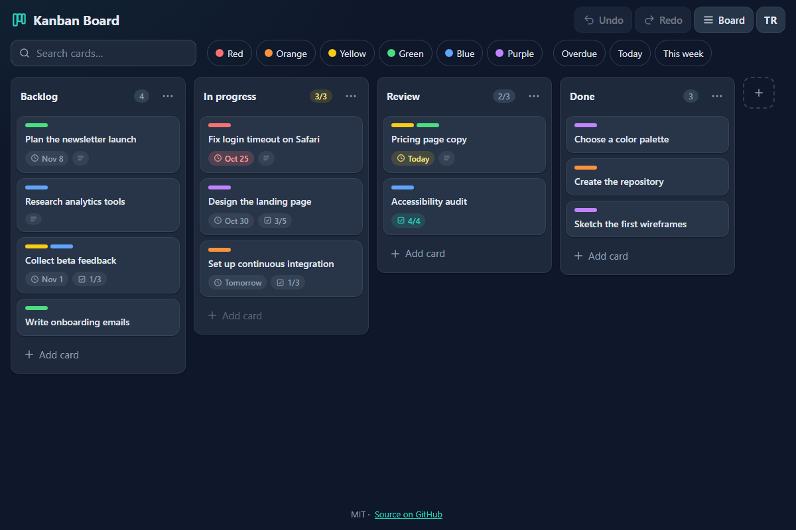

# Kanban Board - a fast, private Kanban board with drag and drop, WIP limits and undo

[](#tests)
[](LICENSE)

**▶ Open the app: https://celaldrg.github.io/kanban/**



## Features

- Columns side by side; the board scrolls sideways (one column at a time on phones).
- Cards with a title, description, up to six colour labels, a due date (red when overdue) and a checklist with progress.
- Drag and drop for mouse, pen and touch: long press on touch, auto-scroll near the edges, a placeholder shows where the card will land.
- Full keyboard control: pick a card up with Space, move it with the arrow keys, drop it with Space.
- WIP limits: a full column is marked and refuses more cards.
- Column menu: rename, set the WIP limit, move left or right, delete.
- Search that ignores case and accents and understands Turkish letters (İ/ı, ş, ğ…), plus label and due-date filters.
- Archive for finished cards, with restore and delete.
- Undo and redo for every change (up to 100 steps), also from the toast after a delete.
- Saved automatically in your browser; export and import the board as JSON.
- English and Turkish interface.
- No accounts, no tracking, no dependencies: plain HTML, CSS and JavaScript modules. Add `?demo` to the address for a sample board that is never saved.

## How to use

**Mouse and keyboard**

- **Add card** at the bottom of a column adds a card; click a card to edit it.
- Drag a card to move it. The **⋯** button on a column opens its settings; the **+** button after the last column adds a column.
- The **Board** menu has the archive, export, import and reset.
- Tab to a card, press **Enter** to open it, or **Space** to pick it up. **←/→** move it to another column (full columns are skipped), **↑/↓** move it inside the column, **Space** drops it and **Escape** cancels.
- With no card picked up, the arrow keys move the focus between cards and columns.
- **Ctrl+Z** undoes, **Ctrl+Y** or **Ctrl+Shift+Z** redoes (**Cmd** on a Mac).

**Touch**

- Swipe sideways to go from column to column.
- Tap a card to edit it. To move it, press and hold until it lifts, then drag; near the screen edge the board scrolls by itself.
- **Filters** shows the label and due-date chips.

## Run locally

It is a static site with no build step. Serve the folder with any static file server, for example:

```sh
npx serve .
```

Then open the address it prints. ES modules need `http://`; opening `index.html` as a `file://` page does not work.

## Tests

```sh
node --test
```

Node.js 22 or newer, no packages to install. The tests cover the board reducer (every action, WIP limits, validation, immutability), batched edits, the store with undo/redo history, keyboard move targets, search and filters (Turkish letters), due dates and date formatting, the saved-file schema and import checks, the storage helper, the sample and demo boards, the drag-and-drop placement math and the translations (both languages have the same texts and placeholders, and every text the interface uses exists).

## Project structure

```
index.html        page, dialogs and static texts
style.css         dark theme, mobile-first layout
src/
  main.js         entry point: wires the board, toolbar, dialogs and shortcuts
  model.js, reducer.js, store.js, history.js, keyboard.js, search.js, dates.js,
  schema.js, persist.js, sample.js, placement.js, format.js, i18n.js
                  pure logic (no DOM), covered by the tests
  storage.js      the only module that touches localStorage
  render.js, board-view.js, drag.js, keymove.js, toolbar.js, *-dialog.js,
  card-editor.js, dialogs.js, feedback.js, transfer.js, dom.js, icons.js
                  user interface
test/             node:test unit tests
docs/             screenshot
```

## License

MIT, see [LICENSE](LICENSE).

## Türkçe

**▶ Uygulamayı aç: https://celaldrg.github.io/kanban/**

### Özellikler

- Yan yana sütunlar; pano yatay kayar (telefonda sütun sütun).
- Kartlarda başlık, açıklama, altı renge kadar etiket, bitiş tarihi (geciktiyse kırmızı) ve ilerlemesi görünen kontrol listesi.
- Fare, kalem ve dokunmayla sürükle-bırak: dokunmada uzun basma, kenarlara yaklaşınca otomatik kaydırma, kartın düşeceği yeri gösteren yer tutucu.
- Tam klavye desteği: kartı Boşluk ile al, ok tuşlarıyla taşı, Boşluk ile bırak.
- WIP sınırı: dolu sütun işaretlenir ve yeni kart kabul etmez.
- Sütun menüsü: yeniden adlandır, WIP sınırını ayarla, sola veya sağa taşı, sil.
- Büyük/küçük harf ve aksan ayırmayan, Türkçe harfleri (İ/ı, ş, ğ…) bilen arama; etiket ve bitiş tarihi filtreleri.
- Biten kartlar için arşiv; geri yükleme ve kalıcı silme.
- Her değişiklik için geri al ve yinele (100 adıma kadar); silmeden sonra çıkan bildirimden de geri alınır.
- Tarayıcıda kendiliğinden kaydedilir; pano JSON olarak dışa ve içe aktarılır.
- İngilizce ve Türkçe arayüz.
- Hesap yok, izleme yok, bağımlılık yok: düz HTML, CSS ve JavaScript modülleri. Adresin sonuna `?demo` eklersen hiç kaydedilmeyen örnek bir pano açılır.

### Nasıl kullanılır

**Fare ve klavye**

- Sütunun altındaki **Kart ekle** yeni kart ekler; kartı düzenlemek için üstüne tıkla.
- Kartı taşımak için sürükle. Sütundaki **⋯** düğmesi sütun ayarlarını açar; son sütunun yanındaki **+** düğmesi yeni sütun ekler.
- **Pano** menüsünde arşiv, dışa aktarma, içe aktarma ve sıfırlama var.
- Tab ile bir karta gel; **Enter** kartı açar, **Boşluk** kartı alır. **←/→** kartı başka sütuna taşır (dolu sütunlar atlanır), **↑/↓** sütun içinde taşır, **Boşluk** bırakır, **Escape** iptal eder.
- Elinde kart yokken ok tuşları odağı kartlar ve sütunlar arasında gezdirir.
- **Ctrl+Z** geri alır, **Ctrl+Y** ya da **Ctrl+Shift+Z** yineler (Mac'te **Cmd**).

**Dokunmatik**

- Sütunlar arasında gezmek için yana kaydır.
- Kartı düzenlemek için dokun. Taşımak için kart kalkana kadar basılı tut, sonra sürükle; ekran kenarına yaklaşınca pano kendisi kayar.
- **Filtreler** düğmesi etiket ve tarih çiplerini gösterir.

### Yerelde çalıştırma

Derleme adımı olmayan statik bir site. Klasörü herhangi bir statik dosya sunucusuyla aç, örneğin:

```sh
npx serve .
```

Sonra yazdığı adresi aç. ES modülleri `http://` ister; `index.html` dosyasını `file://` olarak açmak çalışmaz.

### Testler

```sh
node --test
```

Node.js 22 ya da üstü yeterli, paket kurmak gerekmez. Testler pano reducer'ını (bütün eylemler, WIP sınırları, doğrulama, değişmezlik), toplu düzenlemeleri, geri al/yinele geçmişli store'u, klavyeyle taşıma hedeflerini, aramayı ve filtreleri (Türkçe harfler), bitiş tarihlerini ve tarih biçimlerini, kayıt dosyası şemasını ve içe aktarma denetimlerini, depolama yardımcısını, örnek ve demo panolarını, sürükle-bırak yerleşim hesabını ve çevirileri (iki dilde aynı metinler ve yer tutucular, arayüzün kullandığı her metnin varlığı) kapsar.

### Lisans

MIT, bkz. [LICENSE](LICENSE).
